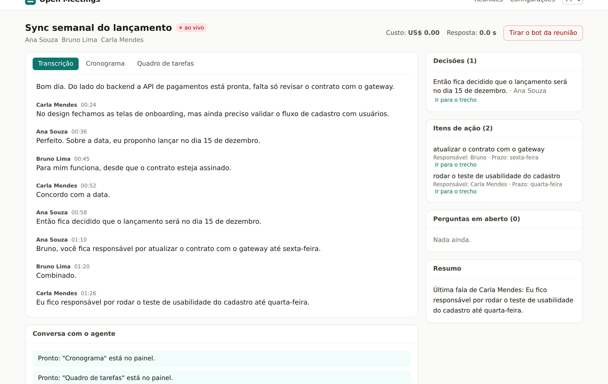
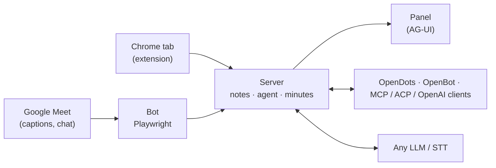

# Open Meetings

**An open source AI meeting agent.** It joins your Google Meet call as a visible participant,
introduces itself, transcribes, keeps the decisions, action items and open questions as the
meeting goes, answers when you call it by name, builds documents, sheets, boards and timelines
on request, and posts the minutes before it leaves. With any LLM, on your own machine or on a
server.

[Português](README.pt-BR.md) · [Docs](docs/) · [Architecture](docs/architecture.md) · [Privacy](docs/privacy.md)



## What it does

- **Joins the call** (Google Meet) under a name that says it is an AI, posts a consent message,
  and leaves on `om sair` from anyone.
- **Transcribes for free** by reading Meet's own live captions, with speaker names. Local or
  hosted Whisper when there are no captions.
- **Keeps structured notes** live: decisions, action items with owner and due date, open
  questions, topics, a running summary. Every entry links to the exact sentence it came from.
- **Answers commands** by voice ("Open Meetings, what are the action items?"), in the call chat
  (`om ...`) or on the panel.
- **Builds artifacts** during the meeting: documents, editable sheets, boards and Gantt
  timelines, exportable to .md, .docx, PDF, .csv, .xlsx and Excalidraw.
- **Acts in your tools** through MCP servers (Linear, GitHub, Trello...) and delegates to coding
  agents over ACP (OpenCode, Claude Code, Codex), always asking for a confirmation first.
- **Remembers**: minutes, semantic search over every meeting, and the pending items of last
  week's meeting when the same meeting happens again.
- **Plugs into other agents** with standard protocols: AG-UI, MCP, ACP and an OpenAI-compatible
  endpoint (works with OpenDots and OpenBot).

## Compared with Claude Meetings

An honest comparison with Anthropic's Claude Meetings (November 2026), the product that
inspired this one.

|                                                           | Claude Meetings                    | Open Meetings                                                                                                            |
| --------------------------------------------------------- | ---------------------------------- | ------------------------------------------------------------------------------------------------------------------------ |
| Platforms                                                 | Google Meet                        | Google Meet (bot), any meeting in a Chrome tab (extension), recorded files. Zoom/Teams planned through external bot APIs |
| Models                                                    | Claude                             | Any: Claude, GPT, Gemini, Groq, OpenRouter, DeepSeek, Ollama, llama.cpp, vLLM, LM Studio...                              |
| Where it runs                                             | Anthropic's cloud                  | Your machine (nothing leaves it), or your server                                                                         |
| Plans                                                     | Team / Enterprise                  | Free, Apache-2.0                                                                                                         |
| External guests                                           | Leaves when one joins              | Configurable: continue, ask, or leave                                                                                    |
| Live notes, artifacts in the meeting                      | Yes                                | Yes                                                                                                                      |
| Citations to the exact quote                              |                                    | Yes                                                                                                                      |
| Search across past meetings, memory of recurring meetings |                                    | Yes                                                                                                                      |
| Interop                                                   |                                    | AG-UI, MCP (client and server), ACP (agent and client), OpenAI-compatible                                                |
| Setup                                                     | None: it is part of Claude         | You host it: `docker compose up`, or `npx`                                                                               |
| Polish and support                                        | A product with a company behind it | A young open source project                                                                                              |
| Joining Meet                                              | Official integration               | Browser automation: Google may refuse the bot, and the host must admit it                                                |

## Quickstart

With Docker, everything local, no API key (first start downloads the models, about 15 GB):

```bash
git clone https://github.com/lcaresia/open-meetings && cd open-meetings
docker compose --profile local up -d
```

Open http://localhost:4319, paste a Meet link, and admit "Open Meetings (assistente IA)" when
it asks to join. With an NVIDIA GPU, add `-f docker-compose.yml -f docker/compose.gpu.yml`.

With hosted models instead (needs keys in `.env`, see `.env.example`):

```bash
cp .env.example .env    # fill in GROQ_API_KEY and ANTHROPIC_API_KEY
docker compose up -d
```

Without Docker (Node 22+):

```bash
npx open-meetings init      # writes openmeetings.config.yaml and .env
npx open-meetings doctor    # checks every engine, shows the cost per hour
npx open-meetings serve
```

Just want to look? `npx open-meetings serve --demo weekly-sync --mock` plays a recorded
meeting on the panel with a built-in deterministic model: no meeting, no key.

## Profiles

| Profile       | Transcript                   | Notes (fast model)          | Commands and minutes (smart model) | Data leaves the machine  | Estimated cost per meeting hour |
| ------------- | ---------------------------- | --------------------------- | ---------------------------------- | ------------------------ | ------------------------------- |
| `local`       | Meet captions, local Whisper | Ollama `qwen2.5:7b`         | Ollama `qwen2.5:14b`               | No (enforced and tested) | US$ 0.00                        |
| `cloud-cheap` | Meet captions                | Groq `llama-3.1-8b-instant` | `claude-haiku-5-5`                 | Text only                | US$ 0.018                       |
| `hybrid`      | Meet captions, local Whisper | Ollama `qwen2.5:7b`         | `claude-sonnet-5-5`                | Commands and minutes     | US$ 0.15                        |
| `cloud-best`  | Meet captions                | `claude-haiku-5-5`          | `claude-opus-5-5`                  | Text only                | US$ 0.34                        |

Costs are estimates from list prices and a fixed workload (notes every 45 s, six commands and
one set of minutes per hour; see `packages/engines/src/cost.ts`). `om doctor` shows the
estimate for your config; the panel shows what each meeting actually cost, call by call.
`pnpm bench --live` measures command latency on your engines and `pnpm eval` scores extraction
quality against recorded meetings. We have not published live latency numbers yet: they depend
on your hardware and providers, and we only publish what we measured.

## How it works



The fast model never sees the whole meeting: every 45 seconds it gets the current notes plus
the new lines and answers with a JSON Patch. That keeps cost flat over long meetings and lets
any client follow the notes live. Details in [docs/architecture.md](docs/architecture.md).

## Integrations

| With                            | How                                                                  | Guide                                                          |
| ------------------------------- | -------------------------------------------------------------------- | -------------------------------------------------------------- |
| OpenDots (CopilotKit)           | Remote MCP server at `/mcp`; AG-UI stream at `/agui`                 | [docs/integrations/opendots.md](docs/integrations/opendots.md) |
| OpenBot                         | ACP agent (`om acp`) or OpenAI-compatible endpoint (`/v1`)           | [docs/integrations/openbot.md](docs/integrations/openbot.md)   |
| Any CopilotKit / AG-UI frontend | `POST /agui`: shared state, interrupts for approvals, frontend tools | [ADR 0005](docs/decisions/0005-agui-mapping.md)                |
| Your tools                      | MCP servers in the config                                            | [docs/mcp.md](docs/mcp.md)                                     |
| Coding agents                   | `tools.acp_agents` in the config                                     | [docs/integrations/openbot.md](docs/integrations/openbot.md)   |

Open Meetings is compatible with these projects and shares no code with them.

## Privacy

The bot always announces itself and anyone can send it away. `om pausar` stops recording on the
spot. With `profile: local` nothing leaves your machine, and a test fails if anything does.
Audio is never stored; transcripts and notes are deleted after `retentionDays` (90 by default)
or on request. Read [docs/privacy.md](docs/privacy.md) before using it with people who did
not choose it.

## Known limitations

- **The Meet bot drives a real browser.** Google changes the page without notice; selectors
  live in one file and a daily check opens an issue when they break. Google may also refuse an
  automated join ("You can't join this video call"), more often for guests: a dedicated Google
  account helps.
- **The host must admit the bot**, like any guest.
- **Meet captions are needed for free transcription.** Their quality and language support are
  Google's. Without them, configure an STT engine.
- **Without Meet captions there are no speaker names** (no diarization yet).
- **Zoom and Teams** are not supported yet (planned through external bot APIs, ADR 0003).
- **Voice replies** (TTS) and the `proactive` mode are configured but not active yet.
- **Postgres** storage is not available yet (SQLite only, ADR 0004).
- Tab-audio capture in the extension needs a click on the toolbar button and is not covered by
  automated tests.

## Development

```bash
pnpm install
pnpm --filter @open-meetings/bot exec playwright install chromium
./scripts/check.sh          # format, lint, typecheck, tests, build
pnpm om replay weekly-sync --mock
```

See [CONTRIBUTING.md](CONTRIBUTING.md). Design decisions are in [docs/decisions](docs/decisions).

## License

[Apache-2.0](LICENSE). Third-party packages and their licenses: [THIRD_PARTY_NOTICES.md](THIRD_PARTY_NOTICES.md).
