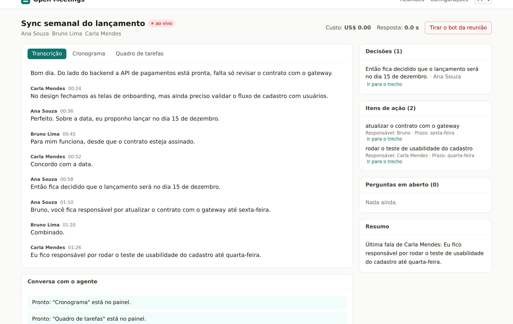

# Open Meetings

**Um agente de reuniões com IA, open source.** Ele entra na sua chamada do Google Meet como
participante visível, se apresenta, transcreve, registra decisões, itens de ação e perguntas em
aberto enquanto a reunião acontece, responde quando é chamado pelo nome, monta documentos,
planilhas, quadros e cronogramas sob pedido, e posta a ata antes de sair. Com qualquer LLM, na
sua máquina ou num servidor.

[English](README.md) · [Documentação](docs/) · [Arquitetura](docs/architecture.md) · [Privacidade](docs/privacy.md)



## O que ele faz

- **Entra na chamada** (Google Meet) com um nome que diz que é uma IA, posta um aviso de
  consentimento e sai com `om sair` de qualquer pessoa.
- **Transcreve de graça** lendo as legendas ao vivo do próprio Meet, com o nome de quem fala.
  Whisper local ou hospedado quando não há legendas.
- **Mantém notas estruturadas** ao vivo: decisões, itens de ação com responsável e prazo,
  perguntas em aberto, tópicos, resumo. Cada item leva à frase exata de onde veio.
- **Atende comandos** por voz ("Open Meetings, quais são os itens de ação?"), no chat da
  chamada (`om ...`) ou no painel.
- **Cria artefatos** durante a reunião: documentos, planilhas editáveis, quadros e cronogramas
  (Gantt), exportáveis para .md, .docx, PDF, .csv, .xlsx e Excalidraw.
- **Age nas suas ferramentas** por servidores MCP (Linear, GitHub, Trello...) e delega para
  agentes de código via ACP (OpenCode, Claude Code, Codex), sempre pedindo confirmação antes.
- **Lembra**: ata, busca semântica em todas as reuniões, e as pendências da reunião da semana
  passada quando a mesma reunião se repete.
- **Conversa com outros agentes** por protocolos abertos: AG-UI, MCP, ACP e um endpoint
  compatível com a API da OpenAI (funciona com OpenDots e OpenBot).

## Comparado com o Claude Meetings

Uma comparação honesta com o Claude Meetings da Anthropic (novembro de 2026), o produto que
inspirou este.

|                                                             | Claude Meetings                     | Open Meetings                                                                                                                 |
| ----------------------------------------------------------- | ----------------------------------- | ----------------------------------------------------------------------------------------------------------------------------- |
| Plataformas                                                 | Google Meet                         | Google Meet (bot), qualquer reunião numa aba do Chrome (extensão), gravações. Zoom/Teams planejados via APIs de bots externos |
| Modelos                                                     | Claude                              | Qualquer um: Claude, GPT, Gemini, Groq, OpenRouter, DeepSeek, Ollama, llama.cpp, vLLM, LM Studio...                           |
| Onde roda                                                   | Nuvem da Anthropic                  | Sua máquina (nada sai dela) ou seu servidor                                                                                   |
| Planos                                                      | Team / Enterprise                   | Gratuito, Apache-2.0                                                                                                          |
| Convidados externos                                         | Sai quando um entra                 | Configurável: continuar, perguntar ou sair                                                                                    |
| Notas ao vivo, artefatos na reunião                         | Sim                                 | Sim                                                                                                                           |
| Citação do trecho exato                                     |                                     | Sim                                                                                                                           |
| Busca em reuniões passadas, memória de reuniões recorrentes |                                     | Sim                                                                                                                           |
| Interoperabilidade                                          |                                     | AG-UI, MCP (cliente e servidor), ACP (agente e cliente), compatível com OpenAI                                                |
| Instalação                                                  | Nenhuma: faz parte do Claude        | Você hospeda: `docker compose up` ou `npx`                                                                                    |
| Acabamento e suporte                                        | Um produto com uma empresa por trás | Um projeto open source novo                                                                                                   |
| Entrada no Meet                                             | Integração oficial                  | Automação de navegador: o Google pode recusar o bot, e o anfitrião precisa admiti-lo                                          |

## Começo rápido

Com Docker, tudo local, sem nenhuma chave de API (a primeira vez baixa os modelos, uns 15 GB):

```bash
git clone https://github.com/lcaresia/open-meetings && cd open-meetings
docker compose --profile local up -d
```

Abra http://localhost:4319, cole um link do Meet e admita "Open Meetings (assistente IA)" quando
ele pedir para entrar. Com GPU NVIDIA, acrescente
`-f docker-compose.yml -f docker/compose.gpu.yml`.

Com modelos hospedados (precisa das chaves no `.env`, veja `.env.example`):

```bash
cp .env.example .env    # preencha GROQ_API_KEY e ANTHROPIC_API_KEY
docker compose up -d
```

Sem Docker (Node 22+):

```bash
npx open-meetings init      # gera openmeetings.config.yaml e .env
npx open-meetings doctor    # testa cada motor e mostra o custo por hora
npx open-meetings serve
```

Só quer ver? `npx open-meetings serve --demo weekly-sync --mock` toca uma reunião gravada no
painel com um modelo determinístico embutido: sem reunião e sem chave.

## Perfis

| Perfil        | Transcrição                     | Notas (modelo rápido)       | Comandos e ata (modelo forte) | Dados saem da máquina     | Custo estimado por hora de reunião |
| ------------- | ------------------------------- | --------------------------- | ----------------------------- | ------------------------- | ---------------------------------- |
| `local`       | Legendas do Meet, Whisper local | Ollama `qwen2.5:7b`         | Ollama `qwen2.5:14b`          | Não (garantido e testado) | US$ 0,00                           |
| `cloud-cheap` | Legendas do Meet                | Groq `llama-3.1-8b-instant` | `claude-haiku-5-5`            | Só texto                  | US$ 0,018                          |
| `hybrid`      | Legendas do Meet, Whisper local | Ollama `qwen2.5:7b`         | `claude-sonnet-5-5`           | Comandos e ata            | US$ 0,15                           |
| `cloud-best`  | Legendas do Meet                | `claude-haiku-5-5`          | `claude-opus-5-5`             | Só texto                  | US$ 0,34                           |

Os custos são estimativas a partir dos preços de tabela e de uma carga fixa (notas a cada 45 s,
seis comandos e uma ata por hora; veja `packages/engines/src/cost.ts`). O `om doctor` mostra a
estimativa do seu config; o painel mostra quanto cada reunião custou de fato, chamada por
chamada. `pnpm bench --live` mede a latência dos comandos nos seus motores e `pnpm eval` mede a
qualidade da extração contra reuniões gravadas. Ainda não publicamos números de latência ao
vivo: eles dependem do seu hardware e dos provedores, e só publicamos o que medimos.

## Como funciona

O modelo rápido nunca vê a reunião inteira: a cada 45 segundos ele recebe as notas atuais e só
as falas novas, e responde com um JSON Patch. O custo fica estável em reuniões longas e
qualquer cliente acompanha as notas ao vivo. Detalhes em
[docs/architecture.md](docs/architecture.md).

## Integrações

| Com                                  | Como                                                                                     | Guia                                                           |
| ------------------------------------ | ---------------------------------------------------------------------------------------- | -------------------------------------------------------------- |
| OpenDots (CopilotKit)                | Servidor MCP remoto em `/mcp`; stream AG-UI em `/agui`                                   | [docs/integrations/opendots.md](docs/integrations/opendots.md) |
| OpenBot                              | Agente ACP (`om acp`) ou endpoint compatível com OpenAI (`/v1`)                          | [docs/integrations/openbot.md](docs/integrations/openbot.md)   |
| Qualquer frontend CopilotKit / AG-UI | `POST /agui`: estado compartilhado, interrupção para aprovações, ferramentas do frontend | [ADR 0005](docs/decisions/0005-agui-mapping.md)                |
| Suas ferramentas                     | Servidores MCP no config                                                                 | [docs/mcp.md](docs/mcp.md)                                     |
| Agentes de código                    | `tools.acp_agents` no config                                                             | [docs/integrations/openbot.md](docs/integrations/openbot.md)   |

O Open Meetings é compatível com esses projetos e não compartilha código com eles.

## Privacidade

O bot sempre se anuncia e qualquer pessoa pode tirá-lo da reunião. `om pausar` para a gravação
na hora. Com `profile: local` nada sai da sua máquina, e um teste falha se algo sair. Áudio
nunca é guardado; transcrições e notas são apagadas depois de `retentionDays` (90 por padrão)
ou quando você pedir. Leia [docs/privacy.md](docs/privacy.md) antes de usar com pessoas que não
escolheram isso.

## Limitações conhecidas

- **O bot do Meet controla um navegador de verdade.** O Google muda a página sem aviso; os
  seletores ficam num arquivo só e uma checagem diária abre uma issue quando quebram. O Google
  também pode recusar a entrada automatizada ("You can't join this video call"), mais ainda como
  convidado: uma conta Google dedicada ajuda.
- **O anfitrião precisa admitir o bot**, como qualquer convidado.
- **A transcrição gratuita depende das legendas do Meet.** Qualidade e idiomas são os do Google.
  Sem elas, configure um motor de STT.
- **Sem as legendas do Meet não há nome de quem fala** (ainda sem diarização).
- **Zoom e Teams** ainda não são suportados (planejados via APIs de bots externos, ADR 0003).
- **Respostas por voz** (TTS) e o modo `proactive` estão no config, mas ainda não ativos.
- **Postgres** ainda não está disponível (só SQLite, ADR 0004).
- A captura do áudio da aba pela extensão precisa de um clique no botão da barra e não tem teste
  automatizado.

## Desenvolvimento

```bash
pnpm install
pnpm --filter @open-meetings/bot exec playwright install chromium
./scripts/check.sh          # formatação, lint, tipos, testes, build
pnpm om replay weekly-sync --mock
```

Veja [CONTRIBUTING.md](CONTRIBUTING.md). As decisões de projeto estão em
[docs/decisions](docs/decisions).

## Licença

[Apache-2.0](LICENSE). Pacotes de terceiros e suas licenças:
[THIRD_PARTY_NOTICES.md](THIRD_PARTY_NOTICES.md).
