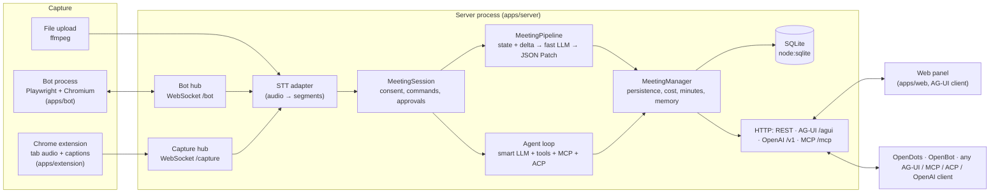

# Architecture

Open Meetings is a TypeScript monorepo (Node 22, pnpm workspaces) with two processes and a
browser extension.

## Flow of one meeting

1. A **capture source** yields events: transcript segments, audio chunks, participants, chat
   messages. Sources are the Meet bot (live captions read from the DOM), the browser extension
   (captions and tab audio), a file upload, or a recorded fixture.
2. Audio, when there is any, goes through the configured **STT engine** in 8-second windows.
   Captions skip this step: on Meet they are free and already carry speaker names.
3. The **session** applies the consent policy (announce, external guests, `om sair`), detects
   commands (wake word, `om ...` in the chat, the panel) and asks for confirmation before
   actions outside the meeting.
4. The **pipeline** keeps a structured `MeetingState`. Every `summaryIntervalSec` (or after a
   long stretch of speech) it sends the fast model the current state plus only the new lines,
   and gets back an RFC 6902 JSON Patch. The patch is validated, applied defensively, and the
   exact diff is published, which is also what AG-UI clients receive as `STATE_DELTA`.
5. Requests that are not built-in commands go to the **agent loop**: the smart model with the
   notes, the recent transcript and every tool (artifacts, search, MCP servers, ACP agents,
   tools the client declared).
6. The **manager** saves everything, meters cost per model call, and when the meeting ends
   writes the minutes, posts them in the call chat, indexes the meeting for search and calls
   the webhook. A recurring meeting (same link or title) starts with the previous occurrence's
   pending items in the agent's memory.

## Packages

| Package            | What it holds                                                                                                    |
| ------------------ | ---------------------------------------------------------------------------------------------------------------- |
| `packages/core`    | Types, `MeetingState` and patches, pipeline, session, commands, prompts, caption stabilizer, test doubles        |
| `packages/config`  | zod schema, YAML loader with `${ENV}`, env overrides, local-network detection                                    |
| `packages/engines` | LLM (OpenAI-compatible, Anthropic), STT, TTS, embeddings, JSON tool fallback, cost meter, local-only fetch guard |
| `packages/tools`   | Agent loop, built-in tools, MCP client, ACP client                                                               |
| `apps/server`      | HTTP server, storage, manager, AG-UI / OpenAI / MCP / ACP adapters, exports, CLI (`om`)                          |
| `apps/bot`         | Meet adapter (selectors, injected observer), bot worker                                                          |
| `apps/web`         | Panel (Vite, React, Tailwind)                                                                                    |
| `apps/extension`   | Chrome MV3 extension                                                                                             |

## Why two processes

A browser automating a meeting is the least reliable part of the system: the DOM changes,
Meet can refuse a join, Chromium can crash. The bot runs as its own process (its own container
in Docker) and talks to the server over one WebSocket. When it dies, only its meetings end; the
server, the panel and every other meeting keep running.

## Decisions

The reasoning behind the non-obvious choices is in [`docs/decisions`](decisions/).
